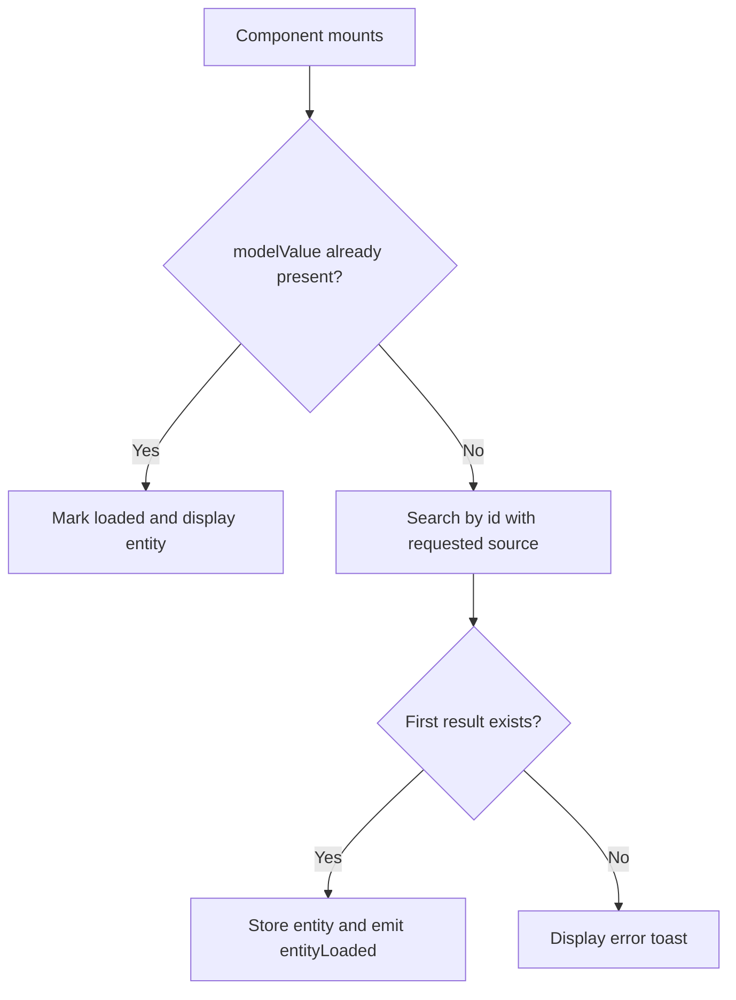

# Documentation patterns

Choose an outline based on the reader's task. These are starting points, not mandatory section lists. Omit topics that do not help the reader and preserve an established project structure when it works.

## Project README

1. Purpose: what the project does and who uses it.
2. Quick start: prerequisites, installation, configuration, required services, launch command, and expected result.
3. System overview: major responsibilities, selected directories, and a short interaction diagram when useful.
4. Common commands: one bullet per command with its purpose and execution context.
5. Configuration and environments: required values, defaults, where they are set, and environment-specific behavior. Use placeholders for credentials.
6. Verification: how to run the relevant checks and any required fixtures or services.
7. Further documentation and contribution workflow: links to the detailed guides and the project's actual development conventions.

Keep exhaustive route, component, and configuration catalogs in dedicated references. Give each fact a primary home and link to it elsewhere.

## Component or API reference

1. Purpose and implementation location.
2. Minimal usage example and the context it requires.
3. Inputs: name, type, required or optional status, default, and constraints.
4. Outputs: returned values, slots, events, exposed methods, and their payloads.
5. Behavior: triggers, requests, validation, state transitions, and side effects.
6. Edge cases and limitations: empty data, errors, cancellation, and refresh semantics where supported.
7. Advanced variants or related components, only when they add a distinct use case.

Use repeatable bullet labels to keep a contract scannable without a table:

- `pageSize?: number`: optional page size; default `200` in the supplied ORM list example.
- `initialEntitiesLoaded`: event emitted with the results of the first successful load in that example.

These values describe the supplied document, not a default for unrelated components. Inspect the target implementation before reusing them.

## Field or value contract

1. Purpose and implementation location.
2. Read shape: type, units, nullability, and empty behavior.
3. Required selection: the field and any nested attributes that must be fetched.
4. Edit behavior: UI representation, conversions, and read-only controls.
5. Write shape: exact payload and any difference from the read shape.
6. Matching selection, sample value, and usage snippet.

For example, the supplied `FieldNumber` documentation describes a `number | null` read value but a `string | null` edit payload. Preserve that distinction if confirmed in code; do not silently document a numeric write just because the component is named “Number.” The date example explicitly uses Unix milliseconds, which must not be abbreviated to an ambiguous “timestamp.”

## Workflow diagrams

Use a short text fence for a linear process. This example summarizes the supplied boundary editing flow:

```text
User edits a field
  -> useORMUI().write(payload)
  -> PATCH the current entity
  -> config.reload()
  -> boundary refreshes the displayed data
```

Describe a failure path separately if it is known. An arrow from PATCH to reload does not establish that failed writes also trigger reload.

Use Mermaid for a meaningful branch if the documentation renderer supports it. This example represents the supplied single-entity boundary's initial-load decision:



The source describes a missing-result toast but does not fully specify transport-error recovery. Do not add retries, fallback rendering, or successful state transitions without implementation evidence. Keep diagrams focused enough to read without zooming, typically 4–8 nodes. Avoid decorative diagrams that merely repeat a list of section headings.

## How to use the supplied sources

- The [README example](examples/README.md) demonstrates breadth and navigation. Its tables and repeated Git-hook explanations are not style requirements. Consolidate repeated facts and bring prerequisites close to setup commands.
- The [boundary example](examples/orm.md) demonstrates explicit responsibilities, load triggers, slots, pagination, and the connection between reading and editing. Its `[...]` and placeholder query snippets are partial examples, not executable code.
- The [field example](examples/orm-fields.md) demonstrates concrete value shapes and nested selections. Its first text-field snippet binds `name` while showing an Email label and mail icon. Align those details when creating a new example; do not reproduce the mismatch.
- The README mentions `bun run test:ci` in its hook explanation but omits it from the commands table. This is a reason to inspect the target package scripts, not evidence that the command exists in another repository.
- The French language, Vue/Odoo stack, environment domains, `release` branch, commit conventions, page size, and debounce values belong to the source project. Carry over the documentation technique, not those project choices.

The three source files under `examples/` are intentionally preserved unchanged. Their relative project links cannot all resolve within this skill because the original implementation is not included. Treat them as historical examples; require working links in newly authored project documentation.
